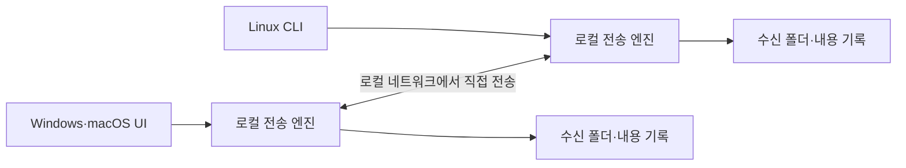

# 초기 설계서

현재 구현 범위와 검증 결과는 [구현 현황](implementation-status.md)을 따른다. 이 문서의 설계 목표 전체가 구현됐다는 의미는 아니다.

- 작성일: 2026-10-25
- 기준: [요구사항 정의서](requirements.md), [분석서](analysis.md)
- 상태: 1차 설계 제안. 사용자 확정 사항 외의 정책과 기술 선택은 변경 가능하다.
- 구현 상태: 1차 구현 진행; 상세 범위는 구현 현황 참조

후속으로 [공통 상세 설계](detailed-design.md), [전송 프로토콜](protocol.md), [화면·CLI 설계](interaction-design.md), [OS별 설계](../README.md), [검증 계획](verification-plan.md)을 작성했다. 아래 내용은 초기 방향의 기록이며 세부 계약과 정책은 후속 문서를 기준으로 한다.

## 1. 전체 구조

각 컴퓨터에 동일한 전송 엔진을 두고, Windows·macOS는 데스크톱 UI, Linux는 CLI로 조작한다. 중앙 서버나 클라우드 저장소 없이 기기끼리 직접 연결한다.



전송 엔진의 책임은 기기 발견, 신뢰 확인, 송수신, 저장, 상태 관리다. UI와 CLI는 같은 동작과 상태 모델을 사용한다. 후속 결정으로 공통 엔진·CLI는 Rust, Windows·macOS 공통 화면은 TypeScript, 데스크톱 프레임워크는 Tauri 2로 확정했다. 전송 프로토콜은 후속 상세 문서를 기준으로 하며 개별 라이브러리와 버전은 구현 시 고정한다.

## 2. 기기 발견과 최초 등록

1. 최초 실행 시 고유 기기 ID와 기기 이름을 생성한다. 네트워크 주소가 바뀌어도 ID는 유지한다.
2. 로컬 네트워크의 발견 기능으로 실행 중인 기기를 찾는다. 발견 정보에는 기기 ID, 이름, 접속 주소, 프로토콜 버전을 포함하고 전송 내용은 포함하지 않는다.
3. 처음 연결하는 기기는 양쪽에서 짧은 확인 코드를 비교하는 방식으로 등록하는 것을 제안한다. Linux에서는 터미널에 코드를 표시한다. 구체적인 인증 방식은 구현 설계에서 선정한다.
4. 등록 후에는 전송마다 승인 없이 자동 수신한다. 발견된 기기라는 이유만으로 신뢰하지 않는다.
5. 이름이 같아도 ID로 구분하며, 설정에서 등록 해제를 지원한다.

기기 상태는 미등록, 연결 가능, 연결 불가로 표시한다. 발견 정보가 남아 있어도 실제 연결이 실패하면 즉시 오류를 표시한다. 자동 발견 방식은 mDNS/DNS-SD 등을 검토하고, 수동 주소 등록의 필요 여부는 실제 네트워크 검증 후 결정한다.

## 3. 데스크톱 UI

- 트레이 또는 메뉴 막대에서 열 수 있는 작은 전송 창을 기본으로 제안한다.
- 연결 가능한 등록 기기를 이름과 운영체제로 표시한다.
- 대상 선택 후 파일을 드롭 영역에 놓으면 즉시 전송한다. 파일을 고르는 버튼도 제공한다.
- 텍스트 입력 영역에 내용이나 URL을 붙여넣고 보내기를 누르면 전달한다.
- 전송 중 진행률, 완료, 실패, 취소 상태를 표시한다.
- 수신 완료 시 OS 알림을 표시한다. 파일 알림에서는 저장 위치로 접근하고, 텍스트·URL 알림에서는 내용 보기 화면을 연다.
- 내용 보기에는 복사 버튼을 제공하고, URL에는 링크 열기 버튼을 추가한다.
- 항상 떠 있는 위젯 형태는 사용자 선호로 유지하며, 고정 표시 여부와 크기는 화면 설계에서 결정한다.

운영체제가 알림을 차단해도 수신과 저장은 계속하고 앱의 수신 기록에서 확인할 수 있게 한다. 수신 URL은 자동으로 열지 않는다.

## 4. Linux CLI

다음은 기능을 설명하기 위한 예시이며 명령어 이름과 구문은 미확정이다.

```sh
fta service start
fta devices
fta pair <device-id>
fta send --to <device-id> ./photo.jpg
fta send --to <device-id> ./a.txt ./b.mp4
fta text --to <device-id> '간단한 메시지'
fta url --to <device-id> 'https://example.com'
fta inbox
fta inbox show <item-id>
fta config set receive-dir /path/to/inbox
```

백그라운드 서비스가 자동 수신과 저장을 담당하며, CLI는 서비스에 명령을 전달한다. 송신 명령은 수신 측 저장 완료까지 기다린 뒤 결과와 종료 코드를 반환하도록 제안한다. 등록과 설정 명령을 제외한 일상 사용에는 GUI가 필요 없다. 서버에서는 URL을 실행하지 않고 내용을 출력한다.

## 5. 전송과 저장

1. 송신 기기가 대상의 연결 상태와 신뢰 관계를 확인한다.
2. 인증된 암호화 연결을 맺고 전송 ID, 유형, 크기 등의 메타데이터를 전달한다.
3. 수신 측은 저장 경로와 요청을 검증한 뒤 데이터를 스트리밍으로 받는다. 큰 영상을 메모리에 통째로 올리지 않는다.
4. 파일은 수신 폴더의 임시 파일로 저장하고, 크기와 무결성을 확인한다.
5. 검증 성공 후 최종 파일명으로 변경한다. 이름이 겹치면 번호 등의 접미사를 붙여 기존 파일을 보존하는 정책을 제안한다.
6. 텍스트·URL은 로컬 내용 기록에 저장한다.
7. 저장이 완료되면 송신 측에 완료 응답을 보내고 수신 측 알림 또는 CLI 기록을 제공한다.

송신 측이 최종 완료 응답을 받기 전에 연결이 끊기면 성공이나 실패로 단정하지 않고 결과 확인 필요 상태로 표시한다. 전송 ID로 수신 결과를 조회할 수 있도록 설계한다. 오프라인 대상용 대기열은 만들지 않는다.

## 6. 상태와 오류

| 상태 | 의미 |
|---|---|
| 연결 중 | 대상 접속과 인증 진행 중 |
| 전송 중 | 데이터 송수신 중 |
| 저장 확인 중 | 무결성 검증과 최종 저장 처리 중 |
| 완료 | 수신 측 저장 완료 확인 |
| 실패 | 연결·인증·읽기·저장·검증 오류 |
| 취소 | 사용자가 전송 중단 |
| 결과 확인 필요 | 완료 응답을 받지 못해 수신 결과를 확정할 수 없음 |

연결 끊김, 디스크 부족, 쓰기 권한 부족, 송신 중 원본 변경, 지원하지 않는 버전을 구분해 안내한다. 초기 버전에서는 이어받기와 자동 재시도를 보류하고 사용자가 다시 보내도록 제안한다. 실패·취소된 임시 파일을 정리하며, 완료 파일과 혼동되지 않게 한다.

## 7. 로컬 데이터와 보호

| 데이터 | 주요 항목 |
|---|---|
| 내 기기 설정 | ID, 표시 이름, 기기 인증 정보, 수신 폴더 |
| 등록 기기 | ID, 이름, 인증 정보, 최근 연결 상태 |
| 전송 기록 | 전송 ID, 상대 기기, 유형, 시간, 상태, 파일 경로 또는 텍스트 내용 |

인증 정보는 OS가 제공하는 보호 저장소나 제한된 권한의 파일로 관리한다. 전송 경로에는 송신자가 제공한 디렉터리를 사용하지 않으며 수신 폴더 밖에 기록하지 않는다. 파일은 자동 실행하지 않고, 링크 열기는 사용자 동작으로 HTTP·HTTPS URL에 한정하는 것을 제안한다. 기록 삭제 시 실제 수신 파일까지 삭제할지는 별도 정책으로 정한다.

## 8. 다음 설계 단계

1. 데스크톱 전송 창, 수신 내용 화면, 설정 화면과 CLI 사용 흐름을 상세화한다.
2. 최초 등록 방식과 기기별 인증·해제 흐름을 확정한다.
3. 확정한 Rust·TypeScript·Tauri 2 조합으로 백그라운드 실행, OS 알림, 드래그 앤 드롭, CLI 배포 호환성을 검증한다.
4. 발견·인증·전송 프로토콜과 로컬 API, 기록 보존 정책을 정의한다.
5. 실제 4대 환경에서 기기 발견과 운영체제별 양방향 전송을 검증할 계획을 작성한다.

기술 스택은 후속 사용자 결정으로 확정했다. 호환성 검증과 구현은 구현 현황 문서에 별도로 기록한다.
