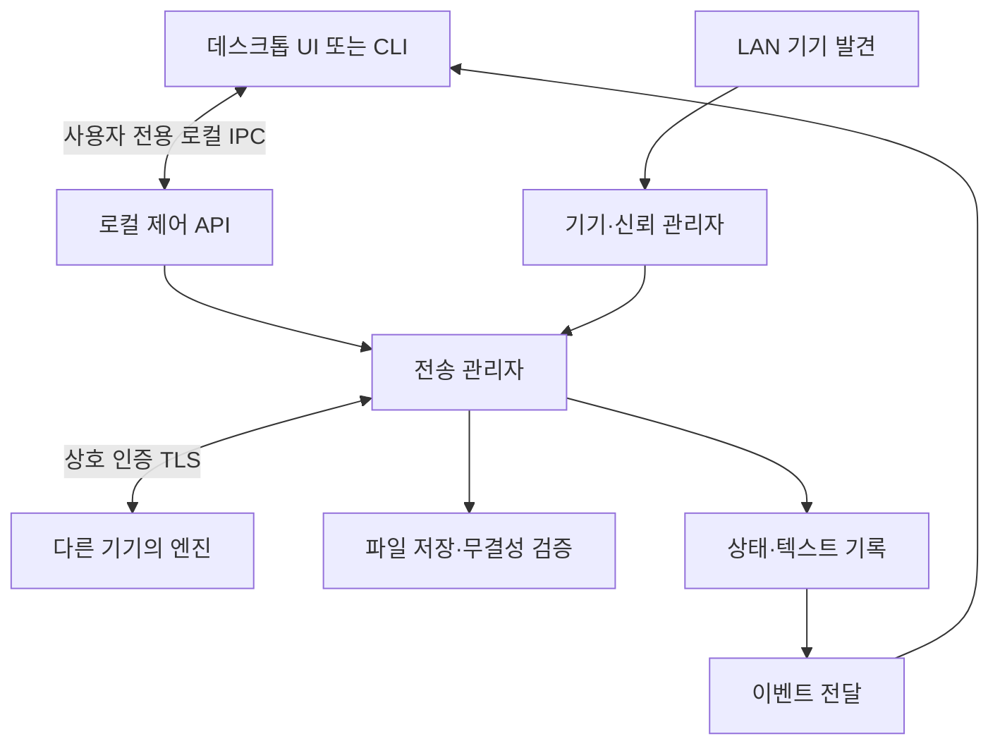

# 공통 상세 설계

현재 구현 범위와 검증 결과는 [구현 현황](implementation-status.md)을 따른다. 이 문서의 설계 목표 전체가 구현됐다는 의미는 아니다.

작성일: 2026-10-25. 상태: 구현 전 설계 기준안. 아래 기본값은 사용자 요구사항에 추가된 설계 결정이며 실제 기기 검증에 따라 조정한다. 제품명은 미정이며 `fta`는 임시 명칭이다.

## 1. 설계 결정

| 항목 | 기준안 | 이유 |
|---|---|---|
| 연결 구조 | 중앙 서버 없이 기기 간 직접 연결 | 집 안 네트워크만 사용 |
| 전송 엔진 | Rust 공통 코어와 백그라운드 실행 파일 | 스트리밍·저장·프로토콜 구현을 세 OS에서 공유 |
| Windows·macOS UI | TypeScript 공통 화면 + Tauri 2 | 화면 코드 공유, OS 통합은 Rust 호스트·플러그인·어댑터로 처리 |
| Linux | Rust CLI와 동일 엔진 | GUI 및 데스크톱 런타임 의존성 제거 |
| MCP | Rust·공식 rmcp SDK, 로컬 stdio | Codex·Claude에서 동일 엔진 제어, 파일 허용 디렉터리 적용 |
| 기기 발견 | mDNS/DNS-SD, 수동 LAN 주소 보조 | 주소 입력 최소화, 멀티캐스트 차단 시 대안 |
| 일반 전송 | TLS 1.3 상호 인증 위의 HTTP API | 등록된 기기만 자동 수신 |
| 최초 등록 | 별도 제한 시간 등록 모드와 인증서 지문 대조 | 일반 전송과 미등록 연결을 분리 |
| 상태·기록 | SQLite와 로컬 설정 파일 | 전송 결과 조회 및 재시작 복구 |

Rust·TypeScript·Tauri 2는 사용자 확정 기술 스택이다. TypeScript 화면의 UI 라이브러리(React 등), 개별 의존성 버전과 최소 OS 버전은 아직 미확정이며 실제 4대의 환경과 호환성 검증 후 고정한다. Windows와 macOS의 화면은 공유하고 OS별로 별도 C#·Swift UI를 만들지 않는다.

데스크톱은 `TypeScript 화면 ↔ Tauri invoke/event ↔ Rust 호스트 ↔ 사용자 전용 로컬 IPC ↔ Rust 엔진` 구조다. Tauri 브리지는 로컬 제어 API를 호출하고 엔진 이벤트를 화면에 전달한다. 엔진은 독립 프로세스로 유지하며 Tauri·WebView 의존성이 없다. Linux CLI는 같은 로컬 IPC로 엔진에 직접 연결한다. OS별 기능은 Tauri API·플러그인을 우선 사용하고, 부족한 기능만 Rust 플랫폼 어댑터로 보완한다.

## 2. 구성과 책임

- `discovery`: 인터페이스 변경, 광고, 검색, 기기 주소 목록 관리.
- `identity`: 기기 ID, 인증서·개인키, 등록 기기, 등록 해제.
- `transport`: 접속, 버전 협상, 시간 제한, 요청 인증.
- `transfer`: 전송 ID, 동시성, 진행률, 취소, 결과 조회.
- `storage`: 이름 정규화, 임시 저장, 해시, 최종 저장, 복구.
- `history`: 기록과 텍스트 보관, 페이지 조회, 삭제.
- `platform`: 키 보호, 자동 실행, 알림, 클립보드, 파일 위치 열기.

TypeScript 화면에는 파일·네트워크·셸에 대한 직접 권한을 주지 않는다. 필요한 Tauri 명령·플러그인 권한만 창별 capability로 허용하고 원격 웹 콘텐츠를 로드하지 않는다. 파일 데이터는 WebView나 JSON 브리지를 통과시키지 않고 엔진에서 스트리밍한다.

엔진은 사용자별 단일 인스턴스다. 데스크톱 UI 창을 닫아도 엔진과 트레이·메뉴 막대는 유지한다. 명시적인 ‘앱 종료’는 수신도 중단한다. Linux는 서비스가 UI 없이 계속 실행된다.

## 3. 연결 범위와 기기 상태

초기 설정에서 집의 네트워크 인터페이스·연결 대역을 허용 목록에 둔다. 자동 발견은 허용 인터페이스에서만 수행하고 수동 주소 역시 직접 연결된 허용 대역으로 제한한다. VPN·터널·외부 주소·공유기 포트 개방은 기본 대상에서 제외한다. 사설 IP라는 이유만으로 집 네트워크라고 판정하지 않는다. 네트워크가 바뀌면 재확인 전까지 광고·수신을 중단한다.

`_fta._tcp.local.`을 임시 서비스 유형으로 사용하며 TXT에는 프로토콜 주 버전, 기기 ID, OS, 최소 기능만 싣는다. 인증 정보와 전송 내용은 광고하지 않는다. 발견 결과는 신뢰 증명이 아니며 실제 TLS 인증으로 확인한다. 다중 주소는 같은 기기 ID로 합친다.

| 상태 | 의미·동작 |
|---|---|
| 발견됨·미등록 | 등록만 가능, 일반 송수신 차단 |
| 연결 확인 중 | 등록 기기의 연결·인증 확인 중 |
| 온라인 | 최근 인증 접속 성공, 전송 대상 선택 가능 |
| 오프라인 | 시간 초과·발견 해제·엔진 종료 등; 전송 불가 |
| 접근 차단 | 키 불일치 또는 등록 해제; 자동 재등록 금지 |

발견 후 실제 접속으로 확인하고 접속 시도 제한은 기본 5초다. 유휴 상태의 온라인 표시는 30초 간격 확인과 발견 갱신을 병행하되 송신 직전 다시 확인한다. 절전·네트워크 전환 시 현재 전송은 실패 또는 결과 확인 필요로 종료하고 재접속을 통해 기기 목록을 갱신한다. 절전 해제나 원격 깨우기는 범위에 넣지 않는다.

## 4. 최초 등록과 키 수명

1. 각 엔진은 무작위 기기 ID와 로컬 인증용 키·자체 서명 인증서를 생성한다.
2. 사용자가 양쪽 기기에서 ‘기기 등록’을 열면 120초 동안 별도 등록용 리스너를 연다. 평소 일반 리스너는 미등록 인증서를 거부한다.
3. 등록 연결은 아직 신뢰하지 않은 인증서를 임시 수용하되 등록 API만 노출한다. 파일·메시지 API와 혼용하지 않는다.
4. 양쪽 화면 또는 CLI에 세션 nonce와 양쪽 인증서 지문을 정해진 순서로 결합한 SHA-256 비교값을 표시한다. 전체 값은 복사 가능하고 기본 비교 화면에는 충분히 긴 그룹화된 값을 표시한다. 짧은 숫자 코드만으로 인증하지 않는다.
5. 사용자가 같은 세션의 비교값을 대조하고 양쪽에서 확정하면 상대 인증서 공개키 지문을 저장한다. 제한 시간 만료·취소·값 불일치 시 폐기한다.
6. 이후 매 전송은 저장된 공개키와 기기 ID를 검증하며 자동 수신한다. 중간에 등록 완료 응답이 끊기면 한쪽만 등록됐을 수 있으므로 상태를 표시하고 등록을 다시 수행한다.

이는 매번 수신 승인이 아니라 최초 기기 등록이다. 키 변경·앱 데이터 초기화 시 재등록하며 이름이나 IP가 같아도 자동 신뢰하지 않는다. 등록 해제는 즉시 새 요청을 차단하고 해당 기기의 진행 중 연결을 닫는다. 반대편의 등록 정보는 별개라 양쪽 삭제 상태가 다를 수 있다. 암호 알고리즘과 인증서 형식은 검증된 TLS 구현에 맞춰 고정하며 자체 암호 프로토콜은 만들지 않는다.

## 5. 로컬 제어 API

Windows는 현재 사용자 SID만 접근 가능한 named pipe, macOS·Linux는 사용자 전용 디렉터리 안의 Unix domain socket을 사용한다. 네트워크 TCP 포트에 로컬 제어 API를 공개하지 않는다. 요청은 길이 제한이 있는 JSON 메시지이며 공통 `request_id`, `method`, `params`와 결과·오류 형식을 갖는다.

| 메서드 | 용도 |
|---|---|
| `devices.list`, `devices.probe` | 기기 목록·연결 확인 |
| `pairing.open`, `pairing.confirm`, `pairing.cancel` | 최초 등록 |
| `transfers.send`, `transfers.cancel`, `transfers.get` | 파일·텍스트 송신·결과 |
| `inbox.list`, `inbox.get`, `inbox.delete` | 수신 기록 |
| `settings.get`, `settings.update` | 이름·수신 경로·자동 실행 등 |
| `events.list`, `events.cursor`, `events.ack` | 영속 완료 이벤트 조회·소비자 커서·처리 확인 |

완료 상태 변경과 이벤트 순번을 같은 DB 트랜잭션에 저장한다. UI는 소비자 커서 이후를 순서대로 조회하고 기록 반영·네이티브 알림 요청 처리 뒤 acknowledge한다. 중단 시 재처리하므로 중복 표시 가능성이 있다. 바이트 진행률은 전송 기록의 `bytes_transferred`를 조회하며 영속 알림 이벤트를 생성하지 않는다. OS 알림의 실제 표시와 정확히 한 번 표시는 보장하지 않는다.

## 6. 데이터 모델과 기본값

| 데이터 | 주요 필드 |
|---|---|
| `devices` | device_id, display_name, os, public_key_pin, paired_at, last_seen |
| `transfers` | transfer_id, peer_id, direction, kind, state, created_at, updated_at, error_code |
| `items` | item_id, transfer_id, ordinal, original_name, saved_name, size, sha256, path, state |
| `messages` | transfer_id, UTF-8 body, message_kind |
| `events`, `event_consumers` | sequence, transfer_id, kind, created_at, summary / consumer, sequence |

전송 ID와 항목 순번에 고유 제약을 두고 SQLite 트랜잭션으로 상태를 갱신한다. 주소와 온라인 여부는 현재 관측값으로 관리하며 DB의 오래된 값을 온라인 근거로 쓰지 않는다. 개인키는 DB에 평문 저장하지 않는다.

| 정책 | 초기 기본값 |
|---|---|
| 동시 전송 | 기기 전체 파일 스트림 송신 2개·수신 2개; 초과 시 BUSY 반환 |
| 여러 파일 | 한 작업 최대 100개 일반 파일, 항목별 결과 제공 |
| 텍스트·URL | UTF-8 최대 1 MiB; URL은 HTTP·HTTPS 단일 주소만 링크로 취급 |
| 파일 크기 | 제품상의 고정 상한 없음; 파일시스템·가용 공간·정수 범위를 검증 |
| 데이터 유휴 제한 | 마지막 데이터 활동 후 60초; 전체 전송 시간 제한 없음 |
| 기록 | 30일 또는 10,000건 기준 오래된 종료 기록 정리; 텍스트 전체 100 MiB 제한 |
| 기록 정리 | 현재 진행·미확정 전송 제외; 수신 파일은 삭제하지 않음 |
| 자동 실행 | 최초 설정에서 선택, 이후 설정 유지 |

크기·시간·보존 기본값은 구현 검증을 위한 제안이다. 용량 초과 시 오래된 종료 기록부터 정리하고 공간을 확보할 수 없으면 새 텍스트 수신을 명시적으로 실패시킨다.

## 7. 저장과 복구

수신 폴더 선택 시 존재·쓰기 권한을 검증한다. 경로 변경은 새 전송부터 적용하고 진행 중 전송은 기존 목적지를 유지한다. 송신 파일은 일반 파일만 허용하고 디렉터리·심볼릭 링크·장치 파일은 거부한다. 여러 파일의 부분 성공은 허용하며 전체 작업을 일괄 성공으로 표시하지 않는다.

수신 측은 basename만 사용하고 `/`, `\`, 제어 문자, `.`·`..`, Windows 예약 이름·후행 점 등을 안전한 이름으로 변환한다. 원래 이름은 기록으로 보존한다. UTF-8 바이트 길이와 대상 파일시스템 한도를 고려해 잘라내고 충돌은 `name (1).ext`처럼 처리한다. 대소문자와 Unicode 비교를 직접 추측하지 않고 원자적 파일 생성으로 충돌을 판정한다.

임시 파일은 수신 폴더 안 `.fta-partials`에 만든다. 경로 이탈과 심볼릭 링크 우회를 막도록 디렉터리 기준 파일 API를 사용한다. 완료 시 파일 flush·가능한 동기화 → 해시 확인 → DB에 최종 저장 의도 기록 → 덮어쓰기 없는 최종 이동 → DB 완료 처리 순서다. 최종 이동과 DB는 하나의 원자적 트랜잭션이 아니므로 재시작 시 의도 기록과 실제 파일을 대조해 복구한다. 플랫폼 파일시스템의 동기화 보장 차이는 검증한다.

재시작 시 미완료 파일은 성공으로 처리하지 않는다. 최종 저장이 확인되는 항목은 완료로 복원하고, 나머지는 중단 처리·임시 파일 정리한다. 재개·자동 재송신은 하지 않는다. 임시 정리가 실패하면 위치와 원인을 기록한다. 송신 파일은 열린 핸들로 읽으며 읽은 크기·해시를 사용하고 크기·수정 정보 변경이 관측되면 오류 처리한다. 동시 수정 파일의 완전한 시점 스냅샷은 보장하지 않는다.

## 8. 관련 문서

- [MCP 도구·설정·권한](mcp.md)
- [데스크톱 UI 설계](ui-design.md)
- [전송 프로토콜](protocol.md)
- [화면과 조작 흐름](interaction-design.md)
- [Windows](platforms/windows.md), [macOS](platforms/macos.md), [Linux](platforms/linux.md)
- [검증 계획](verification-plan.md)
