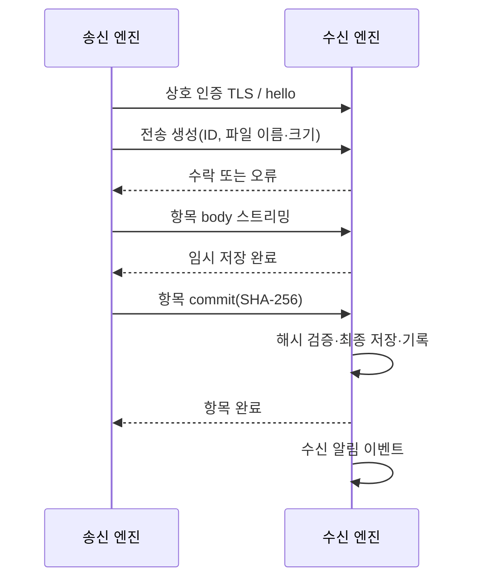

# 전송 프로토콜 상세안 v1

현재 구현 범위와 검증 결과는 [구현 현황](implementation-status.md)을 따른다. 이 문서의 설계 목표 전체가 구현됐다는 의미는 아니다.

작성일: 2026-10-25. 구현 전 API 계약안이다. 라이브러리와 wire format 최종 검증은 구현 단계에서 수행한다.

## 1. 연결과 버전

등록된 기기는 TLS 1.3 상호 인증을 사용하며 시스템 CA 대신 등록한 기기의 공개키 pin과 기기 ID를 검증한다. pin은 인증서 전체 DER가 아닌 SPKI의 SHA-256이다. TLS 서명 검증을 유지하면서 동일 공개키로 갱신한 인증서는 허용하고 다른 공개키는 재등록 전까지 거부한다. 일반 수신 포트는 설정 가능한 TCP 포트로 두고 실제 바인딩된 포트를 mDNS에 광고한다. 임시 기본 포트는 47321이며 충돌 시 조용히 임의 변경하지 않고 오류와 변경 방법을 알린다. mDNS는 UDP 5353을 사용한다. 포트 번호는 제품용 공식 할당을 의미하지 않는다.

HTTP/1.1 기반 `/v1` API를 기준으로 한다. 기능 목록은 `hello` 응답에서 협상하고 주 버전 불일치는 전송 전 거부한다. 파일 body는 바이너리 스트림, 제어 데이터는 UTF-8 JSON이다. 정수 크기는 부호 없는 64비트 범위로 검증하고 JSON에서는 크기를 10진 문자열로 표현해 UI의 정밀도 손실을 막는다. 메타데이터 요청은 최대 256 KiB다.

## 2. API 계약

| 요청 | 동작 |
|---|---|
| `GET /v1/hello` | 인증된 기기 정보, 현재 `display_name`(선택 필드), 버전, 기능, 크기·동시성 제한 |
| `POST /v1/transfers` | ID·종류·항목 메타데이터를 검증하고 수신 슬롯 확보 |
| `PUT /v1/transfers/{id}/items/{n}/body` | 정확한 Content-Length의 파일 스트림 수신 |
| `POST /v1/transfers/{id}/items/{n}/commit` | 송신 중 계산한 SHA-256과 수신 해시 비교·최종 저장 |
| `POST /v1/transfers/{id}/message` | 생성한 텍스트·URL 작업에 내용 저장·완료 |
| `GET /v1/transfers/{id}` | 이 연결의 인증 기기가 생성한 전송의 결과만 조회 |
| `DELETE /v1/transfers/{id}` | 아직 완료하지 않은 항목 취소; 완료 항목은 보존 |

작업 생성 필드: `transfer_id`(무작위 UUID), `kind`(files/text/url), `items`(ordinal, name, size), `created_at`(UTC). 수신 측은 생성 시간에 의존해 인증하지 않는다. 송신자가 주장하는 device_id를 신뢰하지 않고 연결 인증에서 peer_id를 얻는다. 로컬 파일 경로는 전송하지 않는다.

종료 결과에는 작업 상태, 항목별 상태·실제 저장 이름·오류, 수신 측 완료 시각을 포함한다. 수신 폴더의 절대 경로는 원격에 노출하지 않는다. 파일 수신 완료의 응답은 최종 파일과 완료 기록의 저장 이후에만 반환한다.

## 3. 파일 전송 시퀀스

body 성공은 최종 완료가 아니다. 각 파일은 독립적으로 commit한다. 중간 실패 시 이미 저장한 파일은 남기며 작업은 `partial` 결과가 될 수 있다. 원본 0바이트 파일도 지원한다. 제한보다 큰 body, 초과 바이트, 조기 EOF는 실패로 처리한다. 수신 측은 선언 크기와 실제 크기 모두 검증하며 가용 공간은 수시로 변할 수 있으므로 쓰기 오류도 처리한다.

## 4. 중복·불확실 결과·취소

- `(peer_id, transfer_id)`는 고유하다. 같은 ID와 같은 메타데이터의 생성 재요청은 현재 상태를 반환하고 다른 메타데이터는 CONFLICT다.
- 완료된 항목에 같은 commit을 다시 요청하면 기존 결과를 반환한다. 다른 해시는 CONFLICT다. body 재업로드·이어받기는 v1에서 지원하지 않는다.
- 응답 유실 시 송신자는 같은 ID를 조회한다. 수신이 계속 진행 중이면 상태를 표시하고, 완료면 송신 기록을 완료로 바꾼다.
- 조회할 수 없거나 기록이 만료돼 NOT_FOUND이면 성공·실패를 단정하지 않고 결과 확인 필요로 둔다. 이 조회는 전달 대기열이 아니며 payload를 다시 보내지 않는다.
- 사용자가 재전송을 선택하면 새 ID를 사용한다. 기존 수신 결과가 불명확하면 중복 파일 가능성을 안내한다.
- 취소와 최종 저장이 경쟁하면 수신 측 확정 상태가 우선한다. 완료 이후 취소는 파일을 삭제하지 않는다.
- 전송 예약 슬롯은 연결 종료 또는 60초 무활동 시 해제한다. 연결 해제 뒤에도 이미 시작한 최종 저장은 완료할 수 있어 조회가 필요하다.

## 5. 오류와 상태

공통 오류 형식은 `code`, `message`, `retryable`, `transfer_id`, 선택적 `item_ordinal`이다. 원격 오류에 로컬 경로·키·본문은 포함하지 않는다.

| 코드 | 의미 | 기본 동작 |
|---|---|---|
| OFFLINE / TIMEOUT | 접속 불가·유휴 시간 초과 | 실패 표시; commit 이후에는 결과 조회 |
| UNTRUSTED / KEY_CHANGED | 미등록 또는 인증키 불일치 | 전송 차단·등록 상태 확인 |
| VERSION_UNSUPPORTED | 프로토콜 불일치 | 호환 버전 필요 표시 |
| BUSY | 동시성 한도 | 대기열 없이 사용자 재시도 |
| INVALID_REQUEST / TOO_LARGE | 잘못된 이름·종류·크기·본문 | 요청 거부 |
| NO_SPACE / PERMISSION_DENIED | 수신 저장 불가 | 항목 실패·임시 파일 정리 |
| SOURCE_CHANGED / HASH_MISMATCH | 원본 변화·무결성 실패 | 완료 금지 |
| CANCELLED | 취소 | 완료 항목 보존 |
| CONFLICT / NOT_FOUND | ID 충돌·조회 기록 없음 | 자동 재송신 금지 |

항목 상태는 `receiving → verifying → committing → completed` 또는 `failed/cancelled`다. 작업 결과는 `completed/partial/failed/cancelled`로 집계하며 송신 측에만 `unknown`을 추가한다. 모든 파일이 저장된 경우에만 전체 완료다. 부분 성공 수신 알림에는 성공·실패 개수를 표시한다.

## 6. 등록 모드 API

일반 리스너와 분리된 임시 포트에서 `pair/hello`, `pair/confirm`, `pair/status`만 허용한다. 양쪽 인증서, 새 세션 nonce, 비교값에 세션을 바인딩하고 다른 연결의 확정을 재사용하지 않는다. 한 번에 한 세션만 허용하고 만료·요청 빈도 제한을 적용한다. TLS 연결만으로 최초 상대 신원이 확인되는 것은 아니므로 사용자의 양쪽 비교 확인이 필수다. 구현 시 인증서 지문 대조·변조·재전송 공격 테스트를 수행한다.

기기 ID로 등록할 때 임시 등록 주소가 메모리 캐시에 없으면 선택한 허용 인터페이스에서 등록용 mDNS 광고를 최대 기본 연결 제한 시간(현재 5초) 동안 다시 조회한다. 일반 전송 주소를 등록 포트로 추측하거나 등록 요청을 자동 재전송하지 않는다. 조회 실패는 기록 조회의 `NOT_FOUND`와 구분하는 `PAIRING_NOT_FOUND`로 반환한다. 발견된 주소에도 기존 허용 대역 검사와 TLS·양쪽 비교값 확인을 그대로 적용한다.
